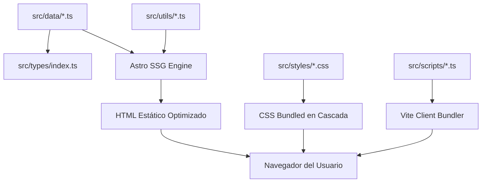

# Arquitectura del Sistema — Once Upon a Timeline

Este documento detalla la estructura técnica, los principios de diseño de software y la separación de responsabilidades implementados en **Once Upon a Timeline**, el archivo interactivo de TWICE construido con **Astro 7**, **TypeScript** y **CSS Vanilla Modular**.

---

## 1. Principios de Arquitectura

El proyecto está diseñado bajo dos pilares clave:
1. **Separación de Responsabilidades (Separation of Concerns - SoC)**: Cada capa (datos, vistas, lógica reactiva del cliente, estilos y utilidades) está claramente desacoplada en carpetas y módulos especializados.
2. **Componentes Atómicos y Reutilizables (Single Responsibility Principle - SRP)**: Los componentes visuales realizan una única tarea de presentación y delegan sub-secciones a componentes hijos dedicados en lugar de crear monolitos.

---

## 2. Mapa del Árbol de Directorios

```text
Once_upon_a_Timeline/
├── .agents/
│   └── skills/              # Skills de diseño UX/UI y modern web design
├── public/
│   ├── assets/
│   │   ├── characters/      # Ilustraciones oficiales de Lovelys y TDOONGZ (.webp)
│   │   ├── covers/          # Portadas oficiales cuadradas de álbumes y sencillos (.webp)
│   │   ├── members/         # Retratos oficiales por era (current, between, classic)
│   │   └── twice-logo.svg   # Emblema vectorial oficial de TWICE
│   ├── favicon.ico
│   └── favicon.svg          # Favicon oficial vectorial de TWICE
├── scripts/
│   ├── scrapers/            # Utilidades de descarga, scraping y normalización de assets
│   └── README.md            # Guía técnica de scripts auxiliares
├── src/
│   ├── components/          # Componentes Astro de presentación
│   │   ├── CharacterTile.astro          # Ficha atómica individual para personajes
│   │   ├── CharactersSection.astro      # Orquestador del escaparate de Lovelys y TDOONGZ
│   │   ├── ClosingSection.astro         # Banner de cierre con gradiente y llamadas a la acción
│   │   ├── DiscographyFilterBar.astro   # UI del buscador, accesos a eras y filtros
│   │   ├── DiscographySection.astro     # Orquestador conciso de la discografía (~60 líneas)
│   │   ├── Footer.astro                 # Pie de página estructurado y créditos
│   │   ├── Header.astro                 # Barra superior fija y navegación móvil
│   │   ├── Hero.astro                   # Portada interactiva, estadísticas y vinilo
│   │   ├── MarketPanel.astro            # Acordeón de mercado (Corea, Japón, Global)
│   │   ├── MemberCard.astro             # Photocard coleccionable de integrante
│   │   ├── MembersSection.astro         # Orquestador de la cuadrícula de miembros
│   │   ├── ReleaseItem.astro            # Ficha de álbum estilo streaming con tracklist
│   │   ├── ScrollToTop.astro            # Botón flotante FAB para volver arriba
│   │   ├── Ticker.astro                 # Marquesina continua infinita
│   │   └── TimelineSection.astro        # Cronología interactiva con hitos y saltos
│   ├── data/                # Fuentes de verdad estáticas fuertemente tipadas
│   │   ├── characters.ts    # Datos de Lovelys y TDOONGZ
│   │   ├── members.ts       # Datos de las 9 integrantes (bios, colores, eras)
│   │   ├── releases.ts      # Catálogo exhaustivo de lanzamientos (Corea, Japón, Global)
│   │   └── timeline.ts      # Hitos históricos y conexiones a lanzamientos
│   ├── layouts/
│   │   └── Layout.astro     # Esqueleto HTML5, metadatos SEO y Open Graph
│   ├── pages/
│   │   └── index.astro      # Página principal estática
│   ├── scripts/             # Lógica cliente TypeScript desacoplada
│   │   ├── discography-explorer.ts  # Búsqueda reactiva, filtros, atajo '/' y hash jump
│   │   ├── member-era-filter.ts     # Conmutador de fotografías de integrantes por era
│   │   ├── navigation.ts            # Menú móvil desplegable y scroll-spy activo
│   │   └── scroll-reveal.ts         # Fallback progresivo con IntersectionObserver
│   ├── styles/              # Sistema de estilos modular (CSS Vanilla)
│   │   ├── animations.css   # Keyframes, animaciones scroll-driven y media queries
│   │   ├── base.css         # Reseteo CSS, tipografía base y utilidades .wrap, .button
│   │   ├── characters.css   # Estilos para personajes y mascotas
│   │   ├── closing-footer.css # Estilos de cierre, pie de página y botón flotante
│   │   ├── discography.css  # Estilos para el explorador y tarjetas de streaming
│   │   ├── global.css       # Manifiesto maestro que importa los módulos en cascada
│   │   ├── header.css       # Cabecera, barra de navegación y drawer móvil
│   │   ├── hero.css         # Portada, disco de vinilo y órbitas
│   │   ├── members.css      # Photocards, efecto shimmer y cajón biográfico
│   │   ├── ticker.css       # Marquesina continua con máscaras de gradiente
│   │   ├── timeline.css     # Línea de tiempo y nodos de pulso radar
│   │   └── tokens.css       # Tokens de diseño: colores oficiales, fuentes, sombras
│   ├── types/
│   │   └── index.ts         # Definiciones TypeScript de modelos del dominio
│   └── utils/               # Funciones auxiliares puras
│       ├── releases.ts      # Agrupación por año, extracción de filtros
│       ├── streaming.ts     # Generación de URLs de Spotify y YouTube Music
│       └── text.ts          # Normalización de acentos y búsqueda insensible
├── docs/                    # Documentación exhaustiva del proyecto
│   ├── ARCHITECTURE.md
│   ├── COMPONENTS.md
│   ├── DESIGN_SYSTEM.md
│   ├── DATA_AND_ASSETS.md
│   └── CONTRIBUTING.md
├── AGENTS.md                # Reglas y directivas de desarrollo para agentes AI
└── README.md                # Guía principal del proyecto
```

---

## 3. Flujo de Datos



1. **Tiempo de compilación (Build Time)**:
   - Astro procesa los archivos `src/data/*.ts` validados contra las interfaces en `src/types/index.ts`.
   - Las funciones de `src/utils/releases.ts` agrupan los lanzamientos por año y mercado de forma determinista.
   - Todo el HTML se renderiza de forma estática (Zero-JS por defecto para el contenido).
2. **Tiempo de ejecución (Runtime)**:
   - Los scripts en `src/scripts/` se cargan de forma diferida (`<script>`) y proporcionan reactividad pura sin necesidad de frameworks pesados (React/Vue).
   - Se mantiene un rendimiento impecable de Core Web Vitals (LCP, INP, CLS).
