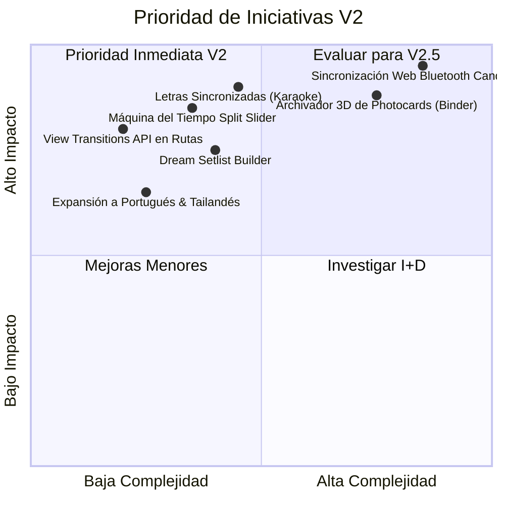

# Vision & Roadmap — Once Upon a Timeline (V2)

> **Documento de Visión Estratégica, Nuevas Experiencias y Hoja de Ruta Tecnológica para la Versión 2.0.**  
> Este documento recopila ideas innovadoras, expansiones de contenido y mejoras arquitectónicas concebidas para llevar el archivo interactivo de TWICE al siguiente nivel de inmersión y coleccionismo digital.

---

## 🌟 Resumen de la Visión & Estado del Proyecto

- **Estado de Versión 1.0 (V1.0.0 Oficial)**: ✅ **100% COMPLETADA Y CERRADA**.
  - Arquitectura multi-página desacoplada sin scroll masivo (`/`, `/musica`, `/giras`, `/fan-zone`, `/moda`).
  - Motor reactivo multi-idioma internacional (ES, EN, KO, JA) con persistencia en `localStorage`.
  - Estante interactivo de álbumes físicos (CD / Vinilo) con vitrina 3D y muro de 12 logros desbloqueables.
  - Bóveda de Coleccionista: Trilogía Candybong con simulador lumínico y Santos Griales de photocards 3D con shaders holográficos.
  - ONCE Fan Zone: Test de afinidad interactivo y Photocard Studio con stickers y descarga en imagen HD vía Canvas API.
  - Modo Concierto (Candybong Night Mode) a 60 FPS con GPU View Transitions API y expansión radial circular (`clip-path`).
  - Créditos y enlace al repositorio de Hugo Adama en el pie de página institucional.

La **Versión 2.0 (V2)** se enfoca en tres ejes transformadores futuros:
1. **Inmersión Sensorial & Web Audio**: Conectar el sonido, la sincronización lumínica y la interactividad en tiempo real.
2. **Coleccionismo Avanzado (3D Binder & Photocard Dex)**: La enciclopedia definitiva de photocards y binders virtuales interactivos.
3. **Comunidad ONCE Global**: Herramientas colaborativas, mapas de giras y utilidades de concierto para los fans en vivo.

---

## 🗺️ Ejes de Innovación para V2

### 1. El Archivador Virtual 3D de Photocards (Virtual 9-Pocket Binder)
- **Concepto**: Permitir a los coleccionistas hojear un archivador clásico de 9 bolsillos (*9-pocket binder*) en 3D con físicas realistas de hojas plásticas y destellos reflectantes.
- **Características**:
  - **Catálogo Completo de Photocards (Photocard-Dex)**: Indexar las photocards oficiales de cada álbum (regular, pre-order benefit POB, broadcast, lucky draw y fan club).
  - **Listas "Tengo" vs "Busco" (Have / Wishlist)**: Sistema de marcado interactivo guardado en `localStorage` o exportable en imagen/JSON para compartir en redes sociales y ferias de intercambio.
  - **Sleeves Personalizados**: Selección de fundas protectoras con hologramas de corazones, estrellas o degradados oficiales.

### 2. Sincronización Web Bluetooth con Candybong Físico Real
- **Concepto**: Llevar la experiencia del concierto a la habitación del usuario conectando el navegador con el lightstick físico mediante la **Web Bluetooth API**.
- **Características**:
  - Emparejamiento Bluetooth nativo desde el navegador Chrome/Edge para **Candybong Z** y **Candybong ∞ Infinity**.
  - Sincronización automática de pulsos y colores según la canción que se esté reproduciendo en el Cinema Vault o Candy Jukebox.
  - Modo Concierto en Pantalla Completa: visuales escénicos inmersivos sincronizados con la luz del lightstick.

### 3. Máquina del Tiempo de Integrantes (Era Comparison Slider)
- **Concepto**: Herramienta visual interactiva con cursor deslizante (*before/after split slider*) para comparar la evolución visual, firmas vocales y estilo de cada integrante.
- **Características**:
  - Selector de eras enfrentadas (ejemplo: *Nayeon en Like OOH-AHH (2015) vs. Nayeon en Strategy (2024)*).
  - Análisis de styling: peinado, concepto estético, killing part y rol en la coreografía.
  - Audios comparativos de sus líneas vocales más representativas en cada era.

### 4. Creador de Setlists de Ensueño (Dream Concert Setlist Builder)
- **Concepto**: Aplicación interactiva donde los fans puedan curar su concierto soñado de TWICE y simular el desarrollo del show.
- **Características**:
  - Drag & Drop de canciones desde las 250+ pistas catalogadas en la discografía.
  - Estructuración por actos: *Acto I (Intro de alto impacto)*, *Acto II (Concepto Madurez/Dark)*, *Acto III (Subunidades & Solos)*, *Encore (Ruleta de canciones al azar)*.
  - Generador de póster oficial del concierto en alta resolución con el nombre del fan y su setlist personalizado para descargar o compartir.

### 5. Sincronización de Letras & Visualizador de Frecuencias (Karaoke Mode)
- **Concepto**: Incorporar letras sincronizadas línea por línea (formato LRC) y visualizador de espectro sonoro en el reproductor.
- **Características**:
  - Letras en 3 modos: Alfabeto original (Hangul / Kanji), Romanización fonética y Traducción (Español / Inglés).
  - Resaltado de líneas en tiempo real según la voz de la integrante que canta cada verso (identificada con su color característico).
  - Visualizador de ondas sonoras reactivas generado en Canvas API con partículas cromáticas.

### 6. Expansión Lingüística Global
- **Concepto**: Ampliar el motor multi-idioma desarrollado en V1 a los mercados donde la comunidad ONCE cuenta con presencia masiva.
- **Nuevos Idiomas Sugeridos**:
  - **Português (`pt`)**: Para la inmensa base de fans en Brasil y América Latina.
  - **ภาษาไทย (`th`)**: Para el sudeste asiático y la gran comunidad en Tailandia.
  - **Bahasa Indonesia (`id`)**: Para el público en Indonesia.

---

## 🛠️ Mejoras Técnicas y de Arquitectura para V2

| Área | Propuesta Técnica | Beneficio |
| :--- | :--- | :--- |
| **Gráficos 3D** | Adopción de **Three.js** o **WebGPU** ligero para el visor del Candybong y el álbum 3D. | Renderizado fotorrealista de materiales plásticos, reflectancia y reflejos de luz física. |
| **Almacenamiento** | Migración progresiva de `localStorage` a **IndexedDB** (`idb-keyval`). | Capacidad ilimitada para guardar imágenes personalizadas y colecciones completas sin límite de 5MB. |
| **Pruebas Automatizadas** | Suite de pruebas E2E con **Playwright** en GitHub Actions. | Validación continua de que los filtros, idiomas y canvas generen resultados exactos en cada commit. |
| **Micro-interacciones** | Uso de **View Transitions API** nativa de Astro entre rutas. | Transiciones fluidas cinematográficas entre páginas sin saltos visuales ni parpadeos. |

---

## 📋 Matriz de Priorización de Tareas

---

## 💡 Conclusión
El archivo en su versión actual es una obra maestra de diseño y rendimiento. Esta hoja de ruta asegura que cualquier desarrollo futuro mantenga la misma elegancia, velocidad y respeto irrestricto por la regla de oro de separación modular, tipado estricto y ausencia de dependencias innecesarias.
